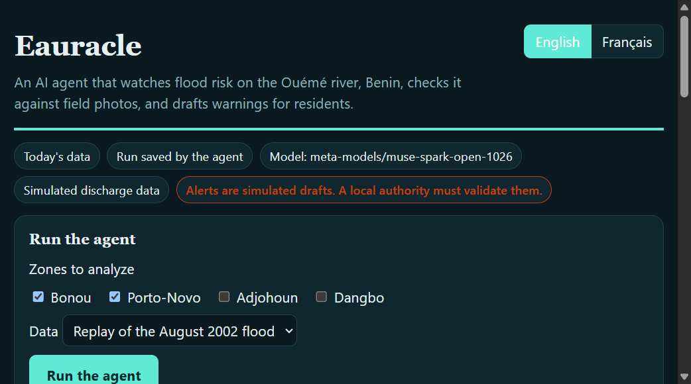

# Eauracle

> **An agentic early-warning prototype that turns Ouémé flood signals and local photos into cautious, human-reviewed alerts.**

[](app/index.html)



**Demo video:** [Watch the 3-minute demo](VIDEO_LINK_TO_ADD)

Eauracle monitors five zones in the Ouémé basin in Benin. A risk model
provides a signal; **Muse Spark Open** decides which tools to call; **SAM 3.1**
measures visible water on a received photo; and the system drafts a French
alert. Alert delivery is simulated and must be validated by a local authority.

## What the demo shows

1. Low risk: monitor and log the decision.
2. Medium/high risk: request a local photo and analyze it.
3. Combine the model signal and visual evidence.
4. Draft a short action-oriented alert and record the reasoning.

The interface supports English/French display, historical replay and current
data. It is a local demo, not a public emergency service.

## How this maps to the judging criteria

| Criterion | What to look at |
|---|---|
| **Impact** | The Ouémé flood-warning problem, human validation boundary and honest limitations in this README; the end-to-end scenario in the video. |
| **Creative use of Meta tools** | Muse Spark tool selection and alert drafting in [agent/boucle.py](agent/boucle.py) and [agent/outils.py](agent/outils.py); water measurement with SAM 3.1 in [vision/segmentation_sam.py](vision/segmentation_sam.py). |
| **Demo quality** | The runnable dashboard and API in [app/index.html](app/index.html) and [app/serveur.py](app/serveur.py), including replay and English/French switching. |
| **Technical execution** | Time-based LightGBM training, explicit fallback/error reporting, execution trace and the independent replay table in [docs/VALIDATION.md](docs/VALIDATION.md). |

## What is new vs. prior work

Only the Eauracle concept existed before the hackathon. The earlier ATUT
notebook used a synthetic Kaggle dataset and is not copied or reused here.
The implementation in this repository was built during the hackathon:
ingestion, regional risk model, agent tools, execution journal, Muse
integration, SAM 3.1 integration, simulated alerts and dashboard.

See [PRIOR_WORK.md](PRIOR_WORK.md) for the precise boundary.

## Models and providers

- **Muse Spark Open** (`meta-models/muse-spark-open-1026`, via Baseten by
  default): agent reasoning, tool calling, alert drafting and image
  description.
- **SAM 3.1** (Meta Model API): segmentation of visible water and estimated
  water coverage on local photos.

The code uses OpenAI-compatible clients for Muse and the Meta Responses API
for SAM. Keys are read from `.env` or environment variables and are never
stored in the repository.

## Data

- River discharge: Open-Meteo Flood API / GloFAS model (**simulated output,
  not station measurements**).
- Current rainfall: Open-Meteo Forecast API.
- Historical rainfall: Open-Meteo Archive API / ERA5 reanalysis.
- Zones: Betérou, Bonou, Adjohoun, Dangbo and Porto-Novo.

The historical cache has a known Bonou gap from 1984 to 1996. See the model
validation and data notes in [docs/VALIDATION.md](docs/VALIDATION.md).

## Run locally

From the repository root, with Python 3.x and internet access:

```powershell
pip install -r requirements.txt
Copy-Item .env.example .env
# Edit .env and add BASETEN_API_KEY (or configure the Meta provider).
python data/historique.py
$env:EAURACLE_CENTILE = "0.90"
$env:EAURACLE_HORIZON = "5"
python risk_model/entrainer.py
python app/serveur.py
```

Open <http://localhost:8000>. The dashboard calls the real local agent through
`POST /api/lancer`. For a deterministic historical run without the UI:

```powershell
python agent/boucle.py Bonou Porto-Novo --rejeu 2002-08-04
```

The replay uses local cache data and local photos under `app/photos/`. Photos,
the execution journal and generated model files are intentionally ignored by
Git. See [docs/PHOTO_SOURCES.md](docs/PHOTO_SOURCES.md) before using any image
publicly.

## Validation and limitations

The model predicts flood onset within a configurable horizon while simulated
discharge is below the zone threshold. Train/validation/test years are
`<=2016`, `2017-2019`, and `>=2020`. The test snapshot is:

- AUC: **0.962** vs **0.960** for the naive discharge-relative baseline
- Average precision: **0.361** vs **0.310** for the naive baseline
- 210 test flood-onset positives

The replay table in [docs/VALIDATION.md](docs/VALIDATION.md) includes the
2017 miss explicitly. The model is a signal among other evidence, not an
autonomous decision-maker.

Required honesty boundaries:

- GloFAS discharge is modelled/simulated, not a station measurement.
- Resident responses and alert delivery are simulated.
- Alerts are drafts for local-authority validation; no real emergency channel
  is connected.
- SAM water-coverage severity thresholds are heuristics, not a safety standard.
- If SAM fails, the result says so and the pipeline falls back to Muse vision
  estimation; it must not claim segmentation succeeded.
- The repository does not promise local-language support, voice input or
  real-world alert dispatch because those features are not implemented.

## Repository map

- `data/`: live ingestion and historical cache builder
- `risk_model/`: features, training, inference and replay inspection
- `agent/`: Muse client, tools, loop and execution journal
- `vision/`: Muse image analysis and SAM 3.1 segmentation
- `app/`: local dashboard and HTTP server
- `docs/`: [architecture](docs/ARCHITECTURE.md), [validation](docs/VALIDATION.md)
  and [photo rights](docs/PHOTO_SOURCES.md)
