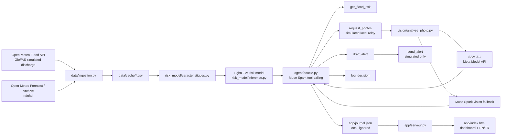

# Eauracle architecture

## Runtime flow

1. `data/ingestion.py` retrieves current discharge and rainfall for the
   monitored Ouémé zones.
2. `data/historique.py` builds local CSV caches for model training and replay.
3. `risk_model/entrainer.py` trains LightGBM with a time-based split. The
   model predicts flood onset while the simulated river is still below its
   zone threshold.
4. `agent/boucle.py` gives Muse Spark Open the risk and verification tools. The
   model chooses whether to monitor, request a photo, analyze it, draft an
   alert and log the decision.
5. `vision/segmentation_sam.py` uses SAM 3.1 to estimate water coverage.
   `vision/analyse_photo.py` falls back to Muse vision if SAM is unavailable
   and labels the method explicitly.
6. `send_alert` returns a simulated delivery result. No real emergency channel
   is connected.
7. `app/serveur.py` exposes `POST /api/lancer` and `GET /api/etat` to the
   local dashboard. The journal and photos remain local and ignored by Git.

## Provider roles

- **Muse Spark Open** (`meta-models/muse-spark-open-1026` via Baseten by
  default): agent reasoning, tool selection, alert drafting and image
  description.
- **SAM 3.1** via the Meta Model API: water segmentation and estimated water
  coverage on a submitted image.
